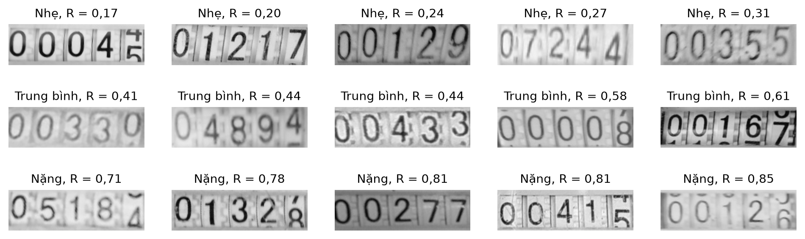
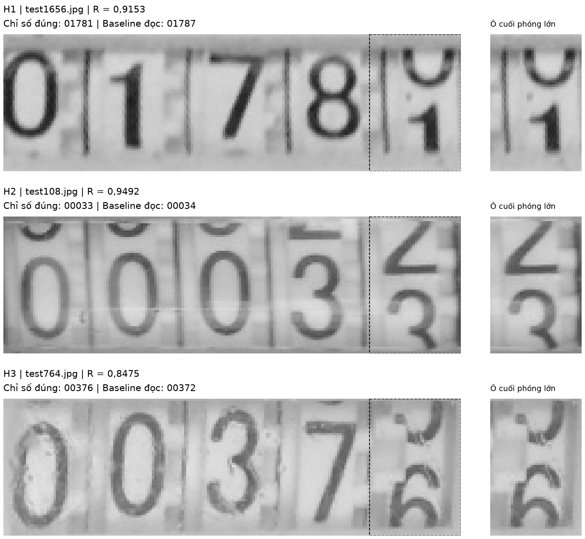
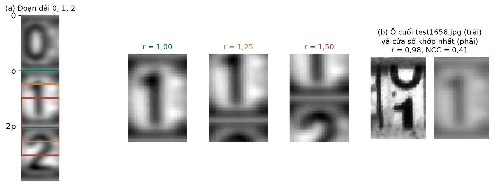
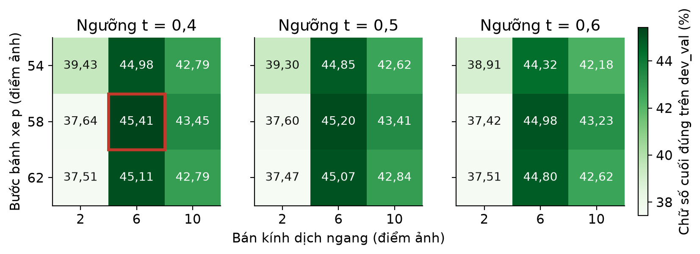
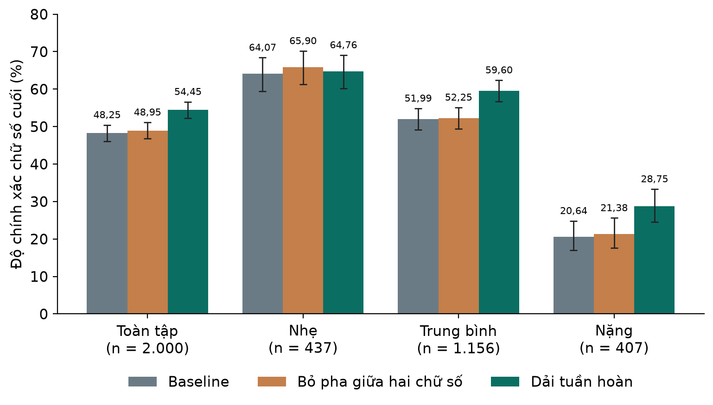
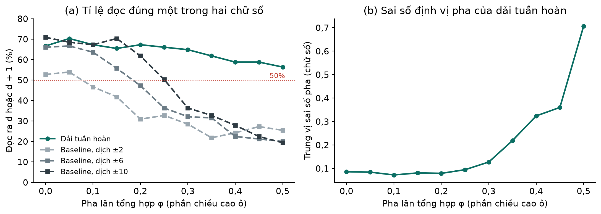
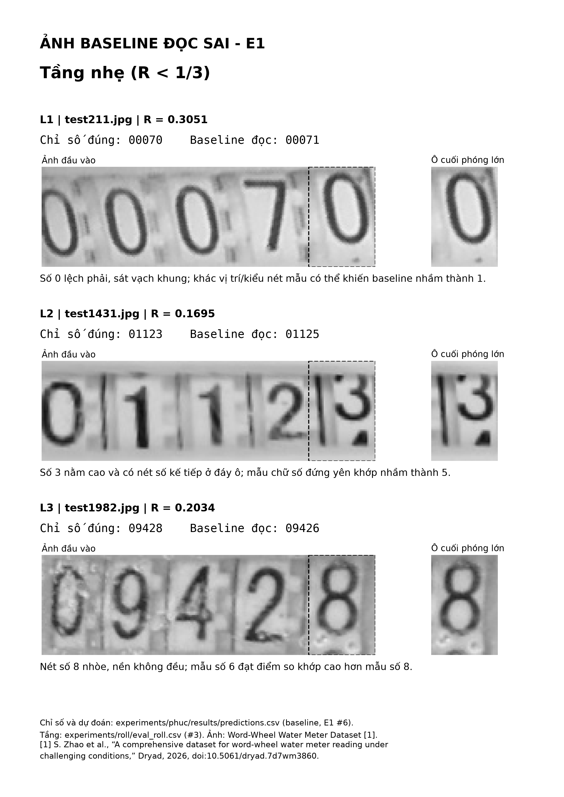
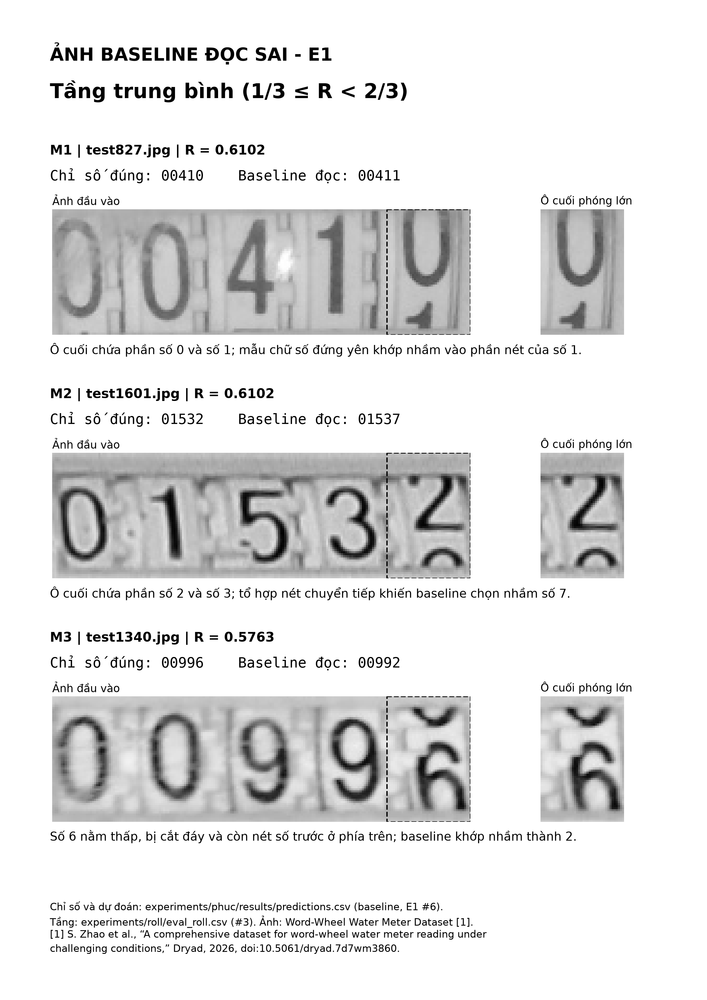

# 1. Đặt vấn đề

## 1.1. Tác vụ và động lực thực tế

Ở nhiều đô thị, chỉ số đồng hồ nước cơ vẫn được ghi bằng cách nhân viên đến từng hộ, chụp ảnh mặt đồng hồ rồi nhập chỉ số vào hệ thống tính tiền. Đọc chỉ số tự động từ ảnh giúp giảm nhập tay, cho phép đối chiếu lại khi khách hàng khiếu nại và phát hiện ảnh chụp không đọc được ngay tại chỗ. Bộ đếm của loại đồng hồ này là một dãy bánh xe số (word-wheel): mỗi bánh xe in mười chữ số 0 đến 9 quanh vành, và một ô cửa sổ chỉ để lộ một phần của vành.

Nhóm chọn tác vụ đọc năm chữ số từ ảnh vùng hiển thị đã được cắt sẵn, và tập trung vào chữ số cuối. Chữ số cuối là bánh xe quay nhanh nhất, nên nó đổi ở hầu hết các lần ghi; một lỗi ở vị trí này làm sai chỉ số của rất nhiều hóa đơn. Đây cũng là vị trí mà cách đọc thông thường thất bại nhiều nhất, như mục 4 cho thấy.

## 1.2. Tuyên bố thách thức

Tuyên bố thách thức đầy đủ được nhóm viết và công bố trong kho mã ngày 14/11/2026, trước khi cài đặt phương pháp đề xuất. Phần dưới đây tóm tắt ba phần A, B, C; các mục 4, 5 và 7 trình bày chi tiết.

A. Bối cảnh và thách thức.

- Tác vụ: đọc chỉ số năm chữ số của đồng hồ nước bánh xe số từ ảnh vùng hiển thị.
- Dữ liệu: phần nhận dạng năm chữ số của bộ Word-Wheel Water Meter Dataset, gồm ảnh chụp thực tế khi ghi chỉ số tại Hàng Châu, Trung Quốc [1], [4] (mục 2).
- Thách thức C: chữ số cuối đang lăn. Khi ảnh được chụp lúc bánh xe đang chuyển từ chữ số d sang d + 1, ô cửa sổ chỉ cho thấy phần dưới của d, khe nền giữa hai chữ số và phần trên của d + 1. Khung cửa sổ che mất một phần của mỗi chữ số, nên đây là một dạng che khuất do chính cơ cấu đồng hồ tạo ra. Cường độ của C là pha lăn φ, tức phần bước bánh xe đã đi qua: φ = 0 khi chữ số nằm giữa ô, φ = 0,5 khi hai chữ số chia đôi ô.
- Kiểu hạn chế F: cách làm thông thường so khớp mỗi ô với mười mẫu chữ số đứng yên. Khi chữ số cuối lăn, không mẫu nào giống nội dung ô và mẫu đạt điểm cao nhất gần như ngẫu nhiên. Trên tập đánh giá, độ chính xác chữ số cuối của baseline giảm từ 64,07% ở tầng lăn nhẹ xuống 20,64% ở tầng lăn nặng, trong khi bốn chữ số đầu vẫn được đọc đúng khoảng 89% đến 91%.
- Giả định thu hẹp: vùng hiển thị đã được cắt và nắn phẳng; hướng ảnh biết trước từ nhãn; chỉ xét đồng hồ năm chữ số với năm ô rộng bằng nhau. Ánh sáng, độ mờ và vết bẩn không được cố định mà giữ ở phân bố tự nhiên của dữ liệu.

B. Lý thuyết của giải pháp. Kỹ thuật P thay mười mẫu rời bằng một dải mẫu tuần hoàn mô phỏng mặt bánh xe trải phẳng, rồi tìm cửa sổ trên dải khớp nhất với ô cuối. Mọi trạng thái lăn đều là một đoạn liên tục của dải, nên pha lăn trở thành một tham số được tìm thay vì là nhiễu. Mục 5 trình bày cơ chế và bốn dự đoán điểm gãy.

C. Tiêu chí kiểm chứng. Thước đo chính là độ chính xác chữ số cuối theo ba tầng lăn của tập đánh giá. Baseline là so khớp mẫu chữ số đứng yên bằng tương quan chéo chuẩn hóa. Mọi tham số được chọn trên tập phát triển, và tập đánh giá chỉ chạy một lần cho mỗi cấu hình đã chốt.

# 2. Dữ liệu

## 2.1. Nguồn gốc và giấy phép

Nhóm dùng bộ Word-Wheel Water Meter Dataset do Zhao và cộng sự công bố trên Dryad ngày 30/01/2026, mã định danh số (digital object identifier, DOI) 10.5061/dryad.7d7wm3860, phiên bản 8 [1], [2]. Bài báo mô tả dữ liệu được đăng trên *Scientific Data* [4]. Giấy phép là Creative Commons Zero 1.0 (CC0-1.0), kiểm tra trực tiếp qua trường `license` trong giao diện lập trình ứng dụng (application programming interface, API) của Dryad [2], [3]. Giấy phép này cho phép sao chép, chỉnh sửa và phân phối lại dữ liệu.

Ảnh được thu thập trong quá trình nhân viên ghi chỉ số đồng hồ tại Hàng Châu. Hệ thống cấp nước ở đây có nhiều đồng hồ cơ với tuổi sử dụng khác nhau, nên ảnh mang đủ các tình huống của điều kiện vận hành: ảnh mờ, mặt đồng hồ bẩn, đất che phủ, thiếu sáng, phản xạ, vùng đọc bị ngược và chữ số đang chuyển tiếp [1], [4]. Nhóm không tự chụp ảnh nào.

## 2.2. Quy mô và nhãn

Bảng 2.1 ghi quy mô do tác giả công bố. Nhóm dùng phần nhận dạng năm chữ số, gồm 13.867 ảnh. Ảnh vùng hiển thị đã được tác giả cắt và biến đổi phối cảnh về 60 × 200 điểm ảnh [4].

Bảng 2.1. Quy mô công bố của bộ dữ liệu [1].

| Thành phần | Tập huấn luyện gốc | Tập kiểm tra gốc | Định dạng |
|---|---:|---:|---|
| Phát hiện vùng đọc (`detection`) | 32.714 | 13.398 | PNG, 512 × 512 |
| Nhận dạng năm chữ số | 11.867 | 2.000 | JPG, cao 60 × rộng 200 |
| Nhận dạng sáu chữ số | 2.555 | 400 | JPG, cao 60 × rộng 200 |

Nhãn do nhóm tác giả gán thủ công [4]. Mỗi dòng của tệp nhãn nhận dạng gồm tên ảnh, chuỗi chỉ số và ba cờ nhị phân: `reversed` (vùng đọc bị ngược), `half-word` (có chữ số đang chuyển tiếp, chỉ hiện một phần của hai chữ số) và `six-digit`. Nhóm giữ chỉ số ở dạng chuỗi để bảo toàn số 0 ở đầu, và dùng cờ `reversed` để xoay ảnh 180° trước mọi bước xử lý (giả định thu hẹp ở mục 1.2).

## 2.3. Chia tập phát triển và tập đánh giá

Tập kiểm tra gốc được giữ nguyên làm tập đánh giá `eval`. Tập huấn luyện gốc được chia thành `dev_fit` để dựng mẫu chữ số và `dev_val` để chọn tham số. Một ảnh huấn luyện vào `dev_val` khi giá trị băm SHA-1 của tên ảnh, đọc như một số nguyên, có số dư dưới 20 khi chia cho 100. Cách chia này không phụ thuộc thứ tự tệp nên tái tạo được trên mọi máy; danh sách ảnh cố định được lưu trong kho.

Bảng 2.2. Các tập dùng trong thực nghiệm.

| Tập | Nguồn | Số ảnh | Có cờ `half-word` | Vai trò |
|---|---|---:|---:|---|
| `dev_fit` | Huấn luyện gốc | 9.577 | 3.399 | Dựng mẫu chữ số |
| `dev_val` | Huấn luyện gốc | 2.290 | 836 | Chọn tham số, lấy ô nguồn cho E4 |
| `eval` | Kiểm tra gốc | 2.000 | 355 | Đánh giá một lần sau khi chốt cấu hình |

## 2.4. Thước đo cường độ thách thức và phân tầng

Cờ `half-word` chỉ là nhãn nhị phân, trong khi độ lăn là một đại lượng liên tục. Nhóm vì vậy đo cường độ thách thức trực tiếp trên ảnh, dựa trên một quan sát hình học: chữ số đứng yên thì khe nền sáng giữa hai chữ số nằm sát mép trên hoặc mép dưới của ô; chữ số lăn đúng nửa bước thì khe nằm giữa ô.

Phép đo trên ô cuối gồm bốn bước. Đầu tiên, ảnh xám được cân bằng histogram rồi nhị phân hóa thích nghi theo trung bình cục bộ (cửa sổ 15 × 15, hằng số trừ 8) để tách nét mực khỏi nền. Tiếp theo, lấy ô chữ số cuối, bỏ 10% mỗi bên để tránh vạch khung, tính tỉ lệ điểm mực trên từng hàng và làm trơn bằng bộ lọc Gauss với σ = 1,5 điểm ảnh, được hồ sơ hàng $p(y)$. Khe là hàng có ít mực nhất trong các hàng cách mép ít nhất 5 điểm ảnh. Cuối cùng, điểm độ lăn là khoảng cách từ khe tới mép gần nhất, chuẩn hóa theo nửa chiều cao ô:

$$R=\frac{\min\left(y^{*},\,H-1-y^{*}\right)}{(H-1)/2},\qquad y^{*}=\arg\min_{5\le y\le H-6}p(y).$$

$R$ nằm trong khoảng [0, 1] và xấp xỉ 2φ. Phép đo chỉ đọc ảnh, không dùng nhãn chỉ số hay cờ `half-word`, nên áp dụng được cho ảnh mới. Cách tính được chọn trên `dev_val` giữa hai phương án, theo khả năng tách ảnh có cờ `half-word` (diện tích dưới đường cong ROC, AUC) và độ lệch giá trị giữa các chữ số khi không lăn: phương án nhị phân hóa thích nghi cho AUC 0,86 và độ lệch 0,08, tốt hơn phương án trung bình độ tối theo hàng (0,83 và 0,16).

Hai ngưỡng 1/3 và 2/3 chia tập đánh giá thành ba tầng. Ngưỡng được đặt theo ý nghĩa hình học của vị trí khe, không dò trên dữ liệu và không chọn theo phân vị. Bảng 2.3 cho thấy tỉ lệ ảnh có cờ `half-word` tăng từ 6,2% ở tầng nhẹ lên 58,7% ở tầng nặng, phù hợp với mục đích của thước đo. Hình 2.1 minh họa năm ảnh ngẫu nhiên mỗi tầng.

Bảng 2.3. Ba tầng lăn của tập đánh giá.

| Tầng | Khoảng $R$ | Số ảnh | Có cờ `half-word` |
|---|---|---:|---:|
| Nhẹ | $R < 1/3$ | 437 | 27 (6,2%) |
| Trung bình | $1/3 \le R < 2/3$ | 1.156 | 89 (7,7%) |
| Nặng | $R \ge 2/3$ | 407 | 239 (58,7%) |
| Tổng | | 2.000 | 355 (17,8%) |

{width=16cm}

Thước đo có hai giới hạn đã biết. Khoảng trống bên trong một chữ số (hàng giữa của số 0 hoặc số 7) có thể bị nhận là khe; ảnh `test1780.jpg` có chữ số cuối gần đứng yên nhưng được xếp tầng nặng với $R = 0{,}81$. Tầng trung bình chiếm 57,8% tập đánh giá và chứa cả ảnh lăn ít lẫn ảnh lăn vừa. Vì vậy các tầng được hiểu là phân tầng theo thước đo ảnh, không phải pha lăn vật lý đo trực tiếp.

# 3. Công trình liên quan

Đọc chỉ số đồng hồ từ ảnh thường gồm ba khâu: định vị vùng hiển thị, chuẩn hóa hình học và nhận dạng chữ số. Bảng 3.1 tóm tắt bốn nguồn mà nhóm đối chiếu, cùng phần kế thừa và phần làm khác.

Bảng 3.1. Công trình liên quan và vị trí của nhóm.

| Công trình | Cách làm và kết quả chính | Nhóm kế thừa | Nhóm làm khác |
|---|---|---|---|
| Zhao và cộng sự [4] | Công bố bộ Word-Wheel; nhận dạng bằng CNN, VGG16, ResNet, DenseNet; DenseNet đạt 98,15% | Dữ liệu, vùng đọc đã nắn, nhãn | Không dùng học sâu; báo cáo theo tầng lăn, điều bài báo không tách |
| Hong và cộng sự [5] | YOLOv3, căn chỉnh hướng, ràng buộc bố cục; phân bố xác suất tuần hoàn cho chữ số lăn | Ý tưởng biểu diễn trạng thái chuyển số theo vòng 0 đến 9 | Dải ảnh mẫu tuần hoàn và so khớp trực tiếp thay cho mạng học xác suất |
| Laroca và cộng sự [6] | Ba mạng nối tiếp định vị, nắn và nhận dạng; 96,98% cả chỉ số trên Copel-AMR | Cách phân tích từng thành phần với đầu vào và baseline cố định | Vùng đọc đã nắn sẵn; tập trung vào ô cuối |
| Lewis [7] | Cách tính tương quan chéo chuẩn hóa nhanh | Điểm tương đồng NCC cho cả baseline và P | Mở rộng tập giả thuyết, không tối ưu cách tính |

Zhao và cộng sự [4] kiểm chứng bộ dữ liệu bằng bốn mạng tích chập; DenseNet đạt độ chính xác 98,15%, và 99,80% khi cho phép sai một chữ số. Bảng kết quả của bài báo không tách theo mức độ lăn, nên các con số này chưa cho biết hiệu quả trên chữ số đang chuyển tiếp. Nhóm kế thừa dữ liệu, vùng đọc đã nắn và nhãn, và coi kết quả học sâu là bối cảnh tham khảo chứ không phải đối thủ so sánh, vì hai bên khác nhau về cách chia tập, tiền xử lý và thước đo.

Hong và cộng sự [5] là công trình gần nhất với thách thức C. Tác giả biểu diễn chữ số đang lăn bằng một phân bố xác suất tuần hoàn (circle probability distribution), xử lý được cả chuyển tiếp từ 9 sang 0. Trên bộ dữ liệu riêng 500 ảnh kiểm tra, cấu hình đầy đủ giảm tỉ lệ lỗi chữ số từ 24,32% xuống 3,79%; phép so sánh này gộp nhiều thành phần nên chưa tách riêng đóng góp của biểu diễn tuần hoàn. [5] đề xuất mô hình hóa vòng 0 đến 9 bằng một phân bố mà mạng phải học; nhóm giữ ý tưởng tuần hoàn nhưng sửa cách hiện thực thành một dải ảnh mẫu xếp theo thứ tự trên bánh xe, vì với so khớp mẫu, một dải liên tục cho phép tìm trực tiếp pha lăn bằng cực đại tương quan mà không cần dữ liệu huấn luyện theo từng pha.

Laroca và cộng sự [6] xây chuỗi ba mạng cho đồng hồ điện và báo cáo đóng góp của từng khâu: bỏ khâu nắn vùng đọc làm độ chính xác cả chỉ số giảm từ 96,98% xuống 95,43%. Nhóm vận dụng cách phân tích này ở thí nghiệm loại bỏ thành phần E3: giữ nguyên đầu vào và baseline, chỉ tắt đúng thành phần xử lý C. Hệ thống của [6] có cơ chế từ chối ảnh độ tin cậy thấp; phương pháp của nhóm trả kết quả cho mọi ảnh, nên mọi phép so với [6] phải nêu rõ phạm vi ảnh được tính.

Lewis [7] trình bày tương quan chéo chuẩn hóa (normalized cross-correlation, NCC) và cách tính nhanh bằng bảng tổng tích lũy. Nhóm dùng NCC làm điểm tương đồng cho cả baseline và P; phần nhóm thay đổi là tập giả thuyết được so khớp, không phải cách tính điểm.

# 4. Phân tích thách thức

## 4.1. Baseline

Baseline là pipeline chuẩn của so khớp mẫu chữ số [7], [8]. Ảnh xám được cân bằng histogram rồi chia thành năm ô rộng bằng nhau. Mỗi mẫu chữ số là ảnh trung bình của các ô mang chữ số đó ở bốn vị trí đầu của 6.178 ảnh `dev_fit` không có cờ `half-word`. Mỗi ô được so với mười mẫu bằng NCC, cho phép trượt tối đa 6 điểm ảnh theo cả hai chiều để bù sai lệch cắt ô, và chữ số có điểm cao nhất được chọn.

## 4.2. Kết quả E1

E1 chạy baseline trên 2.000 ảnh `eval` và báo cáo theo tầng (Bảng 4.1).

Bảng 4.1. Baseline trên tập đánh giá theo tầng lăn.

| Tầng | Số ảnh | Chữ số cuối đúng | Cả chỉ số đúng | Trung bình bốn chữ số đầu |
|---|---:|---:|---:|---:|
| Nhẹ | 437 | 64,07% | 51,49% | 88,62% |
| Trung bình | 1.156 | 51,99% | 39,45% | 90,10% |
| Nặng | 407 | 20,64% | 15,23% | 90,79% |
| Toàn tập | 2.000 | 48,25% | 37,15% | 89,91% |

Độ chính xác chữ số cuối giảm 43,43 điểm phần trăm từ tầng nhẹ sang tầng nặng. Ở tầng nặng, baseline đọc sai gần bốn trên năm ảnh. Trong 1.035 lỗi chữ số cuối trên toàn tập, chỉ 252 lỗi (24,3%) là chữ số kề bên d ± 1; phần lớn lỗi ra một chữ số không liên quan, đúng với biểu hiện "mẫu có điểm cao nhất gần như ngẫu nhiên" của kiểu hạn chế F.

Hình 4.1 cho ba ảnh baseline đọc sai ở tầng nặng; ảnh ở hai tầng còn lại nằm ở Phụ lục B. Ở ảnh H1, ô cuối chứa phần dưới của số 0 và gần trọn số 1; nội dung này khác mọi mẫu nguyên vẹn, và baseline chọn 7. Ở H2, phần dưới của số 2 và phần trên của số 3 cùng hiện trong ô; baseline chọn 4.

{width=14cm}

## 4.3. Lập luận nguyên nhân là C

Mức giảm ở chữ số cuối có thể do một yếu tố khác đi kèm độ lăn, chẳng hạn ảnh tầng nặng tối hơn hoặc mờ hơn. Nhóm kiểm tra ba khả năng như vậy.

Thứ nhất, bốn chữ số đầu nằm trong cùng ảnh, cùng ánh sáng và độ mờ, nhưng hiếm khi lăn. Độ chính xác của chúng không giảm theo tầng (88,62%, 90,10%, 90,79%). Nếu tầng nặng kém do chất lượng ảnh, bốn chữ số đầu cũng phải giảm.

Thứ hai, ba chỉ số chất lượng ảnh đo trên toàn ảnh không xấu đi ở tầng nặng: độ sáng trung bình tăng từ 168,97 lên 173,00, độ tương phản (độ lệch chuẩn mức xám) từ 38,95 lên 39,98, và phương sai Laplacian (đại diện cho độ nét) từ 605,83 lên 653,46 khi đi từ tầng nhẹ sang tầng nặng.

Thứ ba, độ chính xác theo từng chữ số đúng được lưu riêng để kiểm tra ảnh hưởng của phân bố chữ số giữa các tầng.

Ba kiểm tra này ủng hộ việc quy mức giảm cho thách thức C. Chúng chưa loại trừ mọi yếu tố gây nhiễu: nhóm không có kiểm định tương đương và bộ dữ liệu không ghi loại đồng hồ.

# 5. Cơ sở lý thuyết của giải pháp

## 5.1. Đại lượng mà C phá hỏng

Với ô $I$ và mẫu $T$ cùng kích thước, NCC là

$$\rho(I,T)=\frac{\sum_{x,y}\left(I(x,y)-\bar I\right)\left(T(x,y)-\bar T\right)}{\sqrt{\sum_{x,y}\left(I(x,y)-\bar I\right)^2\sum_{x,y}\left(T(x,y)-\bar T\right)^2}}.$$

$\rho$ đạt 1 khi $I$ là một phép biến đổi tuyến tính dương của $T$, nên NCC bất biến với độ sáng và độ tương phản của ô. Đây là lý do NCC hợp với ảnh đồng hồ có ánh sáng không đều.

Gọi mặt bánh xe trải phẳng là ảnh $W$ dài $10p$, trong đó $p$ là bước bánh xe (khoảng cách dọc giữa hai chữ số liên tiếp). Ở pha $\varphi$, ô cuối cao $h$ hiện đoạn $W[(d+\varphi)p,\,(d+\varphi)p+h)$. Mẫu $T_d$ của baseline chỉ mô tả pha 0. Sau khi trượt tốt nhất trong bán kính $s$, phần chồng lên nhau giữa ô và mẫu đúng chỉ còn khoảng $h-\max(0,\varphi p-s)$ hàng; phần còn lại của ô là đầu của chữ số $d+1$, đóng vai trò nhiễu đối với $T_d$. NCC của mẫu đúng vì thế giảm dần theo $\varphi$, và khi $\varphi$ đủ lớn, một mẫu khác có hình dạng tình cờ giống tổ hợp hai nửa chữ số sẽ thắng.

## 5.2. Cơ chế của P

P không thay bước so khớp mà thay tập giả thuyết. Thay vì mười mẫu rời, P dựng một dải $S$ bằng cách xếp mẫu các chữ số 0, 1, ..., 9 theo đúng thứ tự trên bánh xe, mỗi mẫu cao $p$, và nối vòng sau 9 là 0. Mọi cửa sổ cao $h$ bắt đầu tại $y\in[0,10p)$ là một giả thuyết, và

$$y^{*}=\arg\max_{y}\,\rho\left(I,\,S[y,\,y+h)\right),\qquad r=y^{*}/p.$$

Với mọi $\varphi$, nội dung ô là một đoạn liên tục của mặt bánh xe, nên luôn tồn tại một cửa sổ trên dải trùng với ô, sai khác chỉ do nhiễu, ánh sáng và khác biệt giữa các đồng hồ. Pha lăn từ chỗ là nhiễu trở thành một tham số được ước lượng. Phần nguyên của $r$ là chữ số đang ở ô, phần lẻ là pha.

P còn đưa vào một ràng buộc vật lý mà baseline bỏ qua: phần dưới của $d$ luôn đi liền với phần trên của $d+1$. Hai nửa được so khớp cùng nhau trong một cửa sổ, nên một tổ hợp sai thứ tự, ví dụ phần dưới của 3 với phần trên của 7, không bao giờ là giả thuyết. Các cửa sổ gần $y=dp$ gần như trùng với mười mẫu của baseline, nên ở ảnh đứng yên P không có lý do để kém baseline.

Pha liên tục được giải mã thành nhãn rời bằng

$$\hat d=\left\lfloor r+1-t\right\rfloor \bmod 10,$$

với $t$ là ngưỡng chuyển nhãn: khi $r=d+\varphi$, chữ số đọc ra là $d$ nếu phần lẻ $\varphi$ nằm trong $[t-1,\,t)$ và là $d+1$ nếu $\varphi\ge t$. Tác giả bộ dữ liệu không mô tả quy ước gán nhãn ở vùng chuyển tiếp, nên $t$ được chọn trên tập phát triển thay vì cố định ở 0,5.

## 5.3. Nối về nền tảng môn học và thang tính mới

P dựa trên hai nội dung của học phần: so khớp mẫu bằng tương quan chuẩn hóa [8], và tìm phép tịnh tiến bằng cực đại của hàm tương quan. Phần nhóm sửa là bước dựng mẫu: từ mười mẫu rời thành một dải tuần hoàn có thứ tự, và từ một nhãn rời thành một pha liên tục được giải mã bằng ngưỡng. Ý tưởng mô hình hóa trạng thái chuyển số theo vòng đã có ở [5]; nhóm chuyển nó từ biểu diễn xác suất của mạng học sâu sang so khớp mẫu, kèm lập luận cơ chế ở mục 5.1 và 5.2. Theo thang tính mới của đề, việc sửa một bước của thuật toán kèm lập luận cơ chế thuộc mức 2. Các dự đoán định lượng dưới đây, viết trước khi cài đặt và được kiểm chứng ở mục 8, nhằm đạt mức 3.

## 5.4. Dự đoán điểm gãy

Bốn dự đoán dưới đây được công bố trong kho mã ngày 14/11/2026, trước khi P được cài đặt (15/11/2026) và trước khi có bất kỳ kết quả nào trên tập đánh giá. Ký hiệu $s=6$ là bán kính trượt dọc của baseline, $p\approx 58$ là bước bánh xe, $w\approx 5$ là bề rộng nét chữ, cùng đo trên `dev_val`.

1. Baseline gãy ở $\varphi\approx s/p\approx 0{,}10$. Phép trượt bù được độ lăn tới $s$ điểm ảnh; sau đó phần chồng lên mẫu đúng giảm và mẫu đúng mất ưu thế. Hệ quả kiểm chứng được: tăng $s$ thì điểm gãy dời theo tỉ lệ $s/p$.
2. P không gãy theo $\varphi$ ở tầng nhẹ và trung bình: độ chính xác chữ số cuối của P ở hai tầng này chênh nhau không quá vài điểm phần trăm, thay vì 12 điểm như baseline.
3. Lỗi của P dồn quanh ngưỡng chuyển nhãn. Sai số định vị đỉnh NCC cỡ $w/2$ điểm ảnh, nên ảnh có $|\varphi-t|<w/(2p)\approx 0{,}04$ có thể bị đọc sang chữ số kề bên. Dải rủi ro này chiếm chừng một phần tư tầng nặng. Dự đoán: P ở tầng nặng thấp hơn hai tầng kia 10 đến 25 điểm phần trăm, và phần lớn lỗi là lệch đúng một chữ số.
4. P gãy khi bước thật của đồng hồ khác $p$. Dải dùng một bước chung; nếu bước thật lệch $\Delta p$ thì ở pha lớn, nửa trên và nửa dưới của ô không còn khớp cùng một $y$. Khi $|\Delta p|$ vượt khoảng $w$ (khoảng 9% của $p$), đỉnh NCC tách đôi. Dự đoán: ở tầng nặng, P kém rõ ở các ảnh có chiều cao chữ số lệch quá 9% so với trung vị; ở tầng nhẹ thì không.

# 6. Phương pháp

Pipeline gồm sáu bước. Bước 1 đến 4 dùng chung với baseline, nên mọi khác biệt giữa hai phương pháp chỉ đến từ bước 5 và 6.

1. Đọc ảnh và chuẩn hướng. Ảnh được đọc ở mức xám và xoay 180° khi nhãn có cờ `reversed`. Lý do: hướng ảnh nằm ngoài thách thức C và được cố định bằng giả định thu hẹp.
2. Cân bằng histogram trên toàn ảnh. Lý do: kéo giãn tương phản giúp nét chữ mảnh (số 1, số 7) không lẫn vào nền ở ảnh thiếu sáng. NCC vốn đã bất biến với độ sáng của từng ô, nhưng cân bằng histogram còn đưa các ảnh về cùng phân bố mức xám trước khi lấy trung bình để dựng mẫu.
3. Chia năm ô rộng bằng nhau, mỗi ô 40 × 60 điểm ảnh. Lý do: vùng đọc đã được nắn về hình chữ nhật chuẩn, nên chia đều đủ chính xác và sai lệch nhỏ được phép trượt ngang bù lại.
4. Dựng mẫu chữ số. Mỗi mẫu là trung bình các ô mang chữ số đó ở bốn vị trí đầu của ảnh `dev_fit` không có cờ `half-word`. Lý do: bốn vị trí đầu hiếm khi lăn, nên mẫu trung bình gần với chữ số đứng yên; lấy trung bình trên hàng nghìn ô làm giảm nhiễu và vết bẩn của từng ảnh. Bốn chữ số đầu được đọc bằng baseline như cũ.
5. Dựng dải tuần hoàn. Mỗi mẫu được co dọc về chiều cao $p$ rồi xếp nối theo thứ tự 0 đến 9, dải dài $10p$. Mỗi cửa sổ cao 60 hàng bắt đầu tại một hàng $y$ của dải, lấy chỉ số hàng theo modulo $10p$ để cửa sổ qua 9 tiếp tục sang 0. Với $p=58$, dải có 580 cửa sổ. Lý do: co mẫu về $p$ thay vì giữ chiều cao ô 60 làm khoảng cách giữa hai chữ số trên dải bằng bước bánh xe thật, đo được trên `dev_val` (chữ số cao khoảng 54 điểm ảnh, khe khoảng 4 điểm ảnh).
6. So khớp và giải mã ô cuối. Ô cuối được đệm biên ngang $s_x$ điểm ảnh và so với mọi cửa sổ ở mọi độ dời ngang trong $[-s_x, s_x]$. Cửa sổ có NCC lớn nhất cho $r$, và chữ số cuối là $\lfloor r+1-t\rfloor \bmod 10$. Lý do: tìm kiếm dọc là toàn bộ dải nên không cần bán kính trượt dọc; trượt ngang được giữ để bù sai lệch cắt ô như baseline.

Hình 6.1(a) cho một đoạn dải cùng ba cửa sổ ở $r$ = 1,00, 1,25 và 1,50; cửa sổ ở $r$ = 1,50 chứa phần dưới của số 1 và phần trên của số 2, đúng hình ảnh của một ô đang lăn nửa bước. Hình 6.1(b) đặt ô cuối của ảnh H1 ở Hình 4.1 cạnh cửa sổ P chọn: P cho $r$ = 0,98 và đọc đúng chữ số 1, trong khi baseline đọc 7.

{width=16cm}

Mỗi ô cuối cần $580\times(2s_x+1)$ phép tính NCC trên 2.400 điểm ảnh. Nhóm tính toàn bộ bằng một phép nhân ma trận giữa ngân hàng cửa sổ đã trừ trung bình và các mảnh ô đã trừ trung bình, thay cho 7.540 lần gọi hàm so khớp riêng lẻ.

P có ba tham số: bước $p$, bán kính trượt ngang $s_x$ và ngưỡng $t$. Đặt cờ `enabled = False` thì P trở lại đúng baseline; đặt `continuous = False` thì dải chỉ giữ các cửa sổ cách tâm chữ số không quá $s_x$ hàng. Cờ thứ hai là công cụ của thí nghiệm loại bỏ thành phần E3.

# 7. Thiết lập thực nghiệm

## 7.1. Thước đo

Thước đo chính là tỉ lệ đọc đúng chữ số thứ năm. Nhóm báo cáo thêm tỉ lệ đúng cả chỉ số, trung bình độ chính xác bốn vị trí đầu (để thấy P không làm hỏng các vị trí không lăn) và tỉ lệ lỗi lệch đúng một chữ số (để kiểm tra dự đoán 3). Mọi tỉ lệ dùng số ảnh của nhóm tương ứng làm mẫu số và được báo cáo theo toàn tập cùng ba tầng.

Để biết một chênh lệch có lớn hơn dao động do lấy mẫu hay không, nhóm báo cáo khoảng tin cậy 95% Wilson [9] cho từng tỉ lệ. Baseline và P chạy trên cùng ảnh, nên phép so sánh giữa hai phương pháp dùng thiết kế ghép cặp: đếm số ảnh P đúng mà baseline sai ($b$) và ngược lại ($c$), tính khoảng tin cậy 95% cho hiệu hai tỉ lệ ghép cặp, và kiểm định McNemar chính xác (kiểm định nhị thức trên $b$ và $c$) [10].

## 7.2. Chọn tham số

E2 thử 27 tổ hợp trên `dev_val`: bước $p\in\{54, 58, 62\}$ điểm ảnh, bán kính trượt ngang $s_x\in\{2, 6, 10\}$ điểm ảnh và ngưỡng $t\in\{0{,}4; 0{,}5; 0{,}6\}$. Tiêu chí chọn được định trước là độ chính xác chữ số cuối trên toàn `dev_val`; khi bằng điểm, ưu tiên tổ hợp đứng trước trong lưới. Cấu hình chốt là $p$ = 58, $s_x$ = 6, $t$ = 0,4. Cấu hình, mã băm SHA-256 của ba danh sách ảnh và mẫu chữ số được lưu trước khi chạy `eval`, và lệnh đánh giá kiểm tra lại mã băm trước khi chạy.

## 7.3. Thí nghiệm E3 và E4

E3 so ba phiên bản trên cùng 2.000 ảnh `eval`, cùng cấu hình đã chốt: baseline, P bỏ các pha giữa hai chữ số (chỉ giữ cửa sổ cách tâm chữ số không quá 6 hàng) và P đầy đủ.

E4 làm nặng thách thức C có kiểm soát bằng ảnh lăn tổng hợp. Lấy ô cuối của một ảnh `dev_val` không có cờ `half-word` và có $R<0{,}21$ (khoảng 20% ảnh ít lăn nhất) làm chữ số $d$, ghép phía dưới ô của một ảnh khác mang chữ số $(d+1) \bmod 10$ sau khi chuẩn hóa độ sáng trung bình và độ lệch chuẩn của ô thứ hai theo ô thứ nhất, rồi cắt cửa sổ lệch $\varphi$ chiều cao ô. Quét $\varphi$ từ 0 đến 0,50 với bước 0,05 trên 165 cặp (seed 0), giữ nguyên bốn ô đầu. Thước đo là tỉ lệ đọc ra $d$ hoặc $(d+1) \bmod 10$; điểm gãy là pha đầu tiên có tỉ lệ dưới 50%. P được so với baseline có bán kính trượt dọc 2, 6 và 10 điểm ảnh để kiểm tra dự đoán 1. Dự đoán 4 được kiểm tra trên ảnh thật, bằng cách chia mỗi tầng theo việc chiều cao chữ số (đo trên bốn chữ số đầu) có lệch quá 9% so với trung vị hay không.

## 7.4. Tái lập

Mọi bước chạy từ năm lệnh trong kho mã (Phụ lục D), từ chia tập, phân tầng, E2, E1 đến E3 và E4. Ngày 22/11/2026 nhóm chạy lại toàn bộ chuỗi lệnh trên một bản sao sạch của kho với dữ liệu đầy đủ; mọi bảng số trong mục 8 được lấy từ các tệp kết quả của lần chạy đó và khớp với bản đã lưu trong kho.

# 8. Kết quả

## 8.1. E2: ảnh hưởng của tham số

Hình 8.1 cho độ chính xác chữ số cuối trên `dev_val` của 27 cấu hình. Bán kính trượt ngang là tham số ảnh hưởng mạnh nhất: với $p$ = 58 và $t$ = 0,4, tăng $s_x$ từ 2 lên 6 điểm ảnh nâng độ chính xác từ 37,64% lên 45,41%, còn tăng tiếp lên 10 điểm ảnh giảm xuống 43,45%. Bán kính nhỏ không bù được sai lệch cắt ô; bán kính lớn mở thêm vị trí khớp nhầm sang vạch khung và ô bên cạnh, nhưng nhóm chưa kiểm chứng riêng cơ chế này. Bước $p$ và ngưỡng $t$ ảnh hưởng ít: cả chín tổ hợp $(p, t)$ với $s_x$ = 6 nằm trong khoảng 44,32% đến 45,41%. Ở tầng nặng, $p$ = 62 tốt hơn một chút (27,28% so với 25,89%), nhưng cấu hình vẫn chọn theo tiêu chí toàn `dev_val` đã định trước.

{width=16cm}

Ngưỡng $t$ = 0,4 nằm ở biên dưới của lưới. Nhóm dò thêm trên `dev_val` với $p$ = 58, $s_x$ = 6: $t$ = 0,3 cho 45,20%, 0,2 cho 43,67% và 0,1 cho 37,64%, nên 0,4 là cực đại theo $t$ chứ không phải điểm cắt của lưới.

## 8.2. So sánh với baseline theo tầng

Bảng 8.1 và Hình 8.2 so P với baseline trên tập đánh giá.

Bảng 8.1. Độ chính xác chữ số cuối trên tập đánh giá và phép so ghép cặp giữa P và baseline.

| Tầng | Baseline | P | Hiệu | KTC 95% của hiệu | $b$ | $c$ | $p$ |
|---|---:|---:|---:|---|---:|---:|---:|
| Nhẹ | 64,07% | 64,76% | +0,69 | −2,58 đến +3,95 | 28 | 25 | 0,78 |
| Trung bình | 51,99% | 59,60% | +7,61 | +5,16 đến +10,07 | 152 | 64 | 1,9 × 10⁻⁹ |
| Nặng | 20,64% | 28,75% | +8,11 | +4,25 đến +11,97 | 50 | 17 | 6,7 × 10⁻⁵ |
| Toàn tập | 48,25% | 54,45% | +6,20 | +4,42 đến +7,98 | 230 | 106 | 1,1 × 10⁻¹¹ |

Hiệu tính bằng điểm phần trăm; KTC là khoảng tin cậy; $b$ là số ảnh P đúng mà baseline sai, $c$ ngược lại; $p$ là giá trị của kiểm định McNemar chính xác. Khoảng tin cậy 95% Wilson của từng tỉ lệ được vẽ thành thanh lỗi ở Hình 8.2; ví dụ ở tầng nặng, baseline là 16,99% đến 24,84% và P là 24,56% đến 33,33%.

{width=15cm}

P cải thiện chữ số cuối 6,20 điểm phần trăm trên toàn tập. Mức tăng tập trung ở hai tầng có lăn: 7,61 điểm ở tầng trung bình và 8,11 điểm ở tầng nặng, cả hai có khoảng tin cậy không chứa 0 và McNemar $p<10^{-4}$. Ở tầng nhẹ, hiệu chỉ 0,69 điểm và không phân biệt được với 0 ($p$ = 0,78): P không giúp ở ảnh đứng yên, nhưng cũng không làm hại, đúng như lập luận về tập giả thuyết ở mục 5.2. Độ chính xác cả chỉ số tăng từ 37,15% lên 42,10%. Trung bình bốn chữ số đầu giữ nguyên 89,91%, vì P chỉ thay bước đọc ô cuối.

Mức tăng vẫn chưa xóa được khoảng cách giữa các tầng: P đạt 28,75% ở tầng nặng, thấp hơn tầng nhẹ 36 điểm phần trăm. Mục 9 phân tích nguyên nhân.

## 8.3. E3: loại bỏ thành phần

Khi bỏ các cửa sổ nằm giữa hai chữ số, P chỉ còn các giả thuyết gần với mười mẫu rời và kết quả gần như trở về baseline ở cả ba tầng (Hình 8.2): 48,95% trên toàn tập so với 48,25% của baseline, 21,38% ở tầng nặng so với 20,64%. Trong 6,20 điểm P tăng so với baseline, chỉ 0,70 điểm còn lại khi bỏ các pha giữa hai chữ số; 5,50 điểm còn lại đến từ chính các pha đó, tức đúng thành phần nhắm vào thách thức C. Kết quả này loại trừ khả năng mức tăng đến từ những thay đổi phụ như cách co mẫu về chiều cao $p$ hay cách giải mã bằng ngưỡng.

## 8.4. E4: điểm gãy trên ảnh lăn tổng hợp

Hình 8.3 và Bảng 8.2 cho kết quả E4. Ba đường baseline gãy lần lượt ở $\varphi$ = 0,10, 0,20 và 0,30 khi bán kính trượt dọc tăng từ 2 lên 6 rồi 10 điểm ảnh. P không xuống dưới 50% ở pha nào: tỉ lệ đọc đúng một trong hai chữ số giữ trong khoảng 56% đến 70% suốt dải khảo sát.

Bảng 8.2. E4: tỉ lệ đọc ra d hoặc d + 1 trên 165 cặp tổng hợp.

| φ | $R$ đo được | Baseline ±2 | Baseline ±6 | Baseline ±10 | P |
|---:|---:|---:|---:|---:|---:|
| 0,00 | 0,18 | 52,7% | 66,1% | 70,9% | 66,7% |
| 0,10 | 0,34 | 46,7% | 63,6% | 67,3% | 67,3% |
| 0,20 | 0,40 | 30,9% | 47,3% | 61,8% | 67,3% |
| 0,30 | 0,59 | 28,5% | 32,1% | 36,4% | 64,8% |
| 0,40 | 0,77 | 24,2% | 22,4% | 27,9% | 58,8% |
| 0,50 | 0,85 | 25,5% | 20,0% | 19,4% | 56,4% |

{width=16cm}

Hình 8.3(b) cho thấy một giới hạn của P mà độ chính xác không thể hiện: trung vị sai số định vị pha giữ quanh 0,08 chữ số tới $\varphi$ = 0,25, tăng lên 0,13 ở 0,30, 0,22 ở 0,35 và khoảng 0,7 ở 0,50. Ở vùng hai chữ số chia đôi ô, P vẫn đọc ra một trong hai chữ số kề nhau nhưng không còn biết chính xác cửa sổ đang ở đâu giữa chúng, nên ngưỡng $t$ quyết định nhiều hơn pha đo được.

Cột $R$ cho một kiểm chứng độc lập của thước đo độ lăn ở mục 2.4: trên ảnh tổng hợp, $R$ tăng đơn điệu từ 0,18 lên 0,85 khi $\varphi$ tăng từ 0 lên 0,50, gần với quan hệ $R\approx 2\varphi$ ở vùng giữa.

# 9. Thảo luận

## 9.1. Đối chiếu với dự đoán

Bảng 9.1 đối chiếu bốn dự đoán ở mục 5.4 với kết quả.

Bảng 9.1. Kết quả kiểm chứng các dự đoán điểm gãy.

| Dự đoán | Kết quả | Đánh giá |
|---|---|---|
| 1. Baseline gãy ở $\varphi\approx s/p$, dời theo $s$ | Gãy ở 0,10; 0,20; 0,30 với $s$ = 2, 6, 10, so với $s/p$ = 0,03; 0,10; 0,17 | Đúng một phần |
| 2. P không gãy giữa tầng nhẹ và trung bình | Chênh lệch giảm từ 12,08 xuống 5,16 điểm; trên ảnh tổng hợp P không gãy | Đúng một phần |
| 3. Lỗi của P dồn quanh ngưỡng, phần lớn lệch một chữ số | Chỉ 25,2% lỗi ở tầng nặng lệch một chữ số; tầng nặng thấp hơn 31 đến 36 điểm | Sai |
| 4. P gãy khi chiều cao chữ số lệch quá 9% | Tầng nặng: 38,9% ở 18 ảnh lệch so với 28,3% ở 389 ảnh còn lại | Chưa kết luận |

Dự đoán 1 đúng về chiều: điểm gãy dời đều 0,10 mỗi khi $s$ tăng 4 điểm ảnh, so với $4/p\approx 0{,}07$ theo lập luận; chênh lệch này nằm trong một bước lưới 0,05. Nhưng vị trí tuyệt đối muộn hơn $s/p$ khoảng 0,07 đến 0,13. Lập luận ở mục 5.1 bỏ qua việc mẫu đúng vẫn thắng khi phần chồng lên nhau còn đủ lớn so với các mẫu khác, không cần chồng trọn. Số liệu khớp với $(s+w)/p$ khi $w\approx 5$, nhưng quan hệ này được rút ra sau khi xem kết quả nên chưa phải một dự đoán đã kiểm chứng.

Dự đoán 2 đúng trên ảnh tổng hợp, nơi chỉ pha lăn thay đổi. Trên ảnh thật, chênh lệch giữa tầng nhẹ và tầng trung bình của P (5,16 điểm) nhỏ hơn nhiều so với baseline (12,08 điểm), nhưng lớn hơn "vài điểm phần trăm" như đã dự đoán.

Dự đoán 3 sai ở cả hai vế, và đây là phát hiện quan trọng nhất của thực nghiệm. Nếu lỗi của P chủ yếu do định vị pha quanh ngưỡng, phần lớn lỗi phải là chữ số kề bên. Thực tế chỉ 223 trong 911 lỗi chữ số cuối (24,5%) là lệch một chữ số, gần như bằng tỉ lệ của baseline (24,3%). E4 chỉ ra nguyên nhân: ngay ở $\varphi$ = 0, khi trung vị sai số pha chỉ 0,09 chữ số, một phần ba số cặp (33,3%) vẫn bị đọc ra một chữ số khác cả $d$ lẫn $d+1$. Lỗi chính của P vì thế là nhầm hình dạng chữ số, chung với baseline ở ảnh đứng yên, chứ không phải lỗi định vị pha. Mẫu trung bình bị nhòe và kiểu chữ khác nhau giữa các đồng hồ là những ứng viên cho nguyên nhân này; nhóm chưa kiểm chứng riêng từng ứng viên.

Dự đoán 4 chưa kết luận được. Chỉ 18 ảnh tầng nặng có chiều cao chữ số lệch quá 9% trung vị (56,5 điểm ảnh), và kết quả ở nhóm này còn ngược chiều dự đoán; với cỡ mẫu đó, khoảng tin cậy 95% Wilson của 38,9% là từ 20,3% đến 61,4%, chứa cả 28,3% của nhóm còn lại.

## 9.2. Giả định vững nhất và yếu nhất

Giả định vững nhất là vùng hiển thị đã được cắt và nắn phẳng. Nó do tác giả bộ dữ liệu thực hiện, không gỡ bỏ thách thức C vì việc lăn xảy ra bên trong ô cửa sổ, và bốn chữ số đầu đạt gần 90% với cách chia ô đều cho thấy hình học của vùng đọc đủ ổn định.

Giả định yếu nhất là chiều quay của bánh xe. Dải xếp các chữ số theo thứ tự tăng 0, 1, ..., 9, tức giả định phần dưới của $d$ luôn đi liền với phần trên của $d+1$. Trên 836 ảnh `half-word` của `dev_val`, dải xếp xuôi và dải xếp ngược khớp gần như bằng nhau (NCC trung bình 0,420 và 0,421), nên dữ liệu hiện chưa xác định được chiều quay. Nếu chiều thật ngược lại, ràng buộc thứ tự ở mục 5.2 ghép sai cặp nửa chữ số, và phần lợi của P ở pha lớn phải đến từ việc tập giả thuyết rộng hơn chứ không phải từ đúng cấu trúc vật lý. Kết quả E3 cho thấy mức tăng đến từ các pha giữa hai chữ số, nhưng chưa phân biệt được hai cách giải thích này.

Giả định bước bánh xe chung $p$ cho mọi đồng hồ cũng yếu: E2 cho thấy tầng nặng thích $p$ lớn hơn tầng chung, và dự đoán 4 chưa kiểm chứng được vì quá ít ảnh lệch chiều cao.

Nếu nới lỏng giả định hướng ảnh (không có cờ `reversed`), P cần thêm một bước nhận diện ảnh ngược; khi đó ảnh ngược ở pha lớn càng khó vì nửa trên và nửa dưới đổi chỗ. Nếu nới lỏng giả định năm ô đều (đồng hồ sáu chữ số hoặc vùng đọc chưa nắn), cả baseline và P phải định vị lại từng ô trước khi so khớp.

## 9.3. Giới hạn của thực nghiệm

Ảnh tổng hợp của E4 ghép hai ô từ hai đồng hồ khác nhau, dùng chu kỳ bằng chiều cao ô (60 hàng) thay vì bước bánh xe thật, và ô "đứng yên" vẫn có $R\approx 0{,}18$. Kết quả E4 vì thế chỉ cho biết cơ chế, không cho số liệu tuyệt đối. Kho ô đứng yên nhỏ ở một số chữ số (7 ảnh cho chữ số 7), nên 165 cặp lặp lại cùng một số ô. Các phép so trên ảnh thật đều dùng một lần chạy duy nhất trên `eval`; khoảng tin cậy ở mục 8 chỉ phản ánh dao động do lấy mẫu ảnh, không phản ánh dao động do chọn tham số.

# 10. Kết luận

Nhóm xác định thách thức chính của việc đọc đồng hồ nước bánh xe số là chữ số cuối đang lăn, đo cường độ của nó trực tiếp trên ảnh bằng vị trí khe nền và chia tập đánh giá thành ba tầng. Baseline so khớp mẫu chữ số đứng yên giảm từ 64,07% ở tầng nhẹ xuống 20,64% ở tầng nặng, trong khi bốn chữ số đầu không giảm, cho thấy thách thức nằm ở ô cuối.

Phương pháp đề xuất thay mười mẫu rời bằng một dải mẫu tuần hoàn mô phỏng mặt bánh xe, biến pha lăn từ nhiễu thành tham số được ước lượng. Trên 2.000 ảnh đánh giá, độ chính xác chữ số cuối tăng 6,20 điểm phần trăm (khoảng tin cậy 95% từ 4,42 đến 7,98), tập trung ở tầng trung bình (+7,61) và tầng nặng (+8,11), không đổi ở tầng nhẹ. Thí nghiệm loại bỏ thành phần cho thấy gần như toàn bộ mức tăng đến từ các pha nằm giữa hai chữ số. Trên ảnh lăn tổng hợp, baseline gãy ở pha 0,10 đến 0,30 tùy bán kính trượt, còn phương pháp đề xuất không gãy trong toàn dải khảo sát.

Hai trong bốn dự đoán đúng một phần, một dự đoán sai và một chưa kết luận. Dự đoán sai chỉ ra hướng đi tiếp: lỗi còn lại chủ yếu là nhầm hình dạng chữ số chứ không phải lỗi định vị pha. Ba hướng mở rộng theo thứ tự ưu tiên: (1) xác định chiều quay của bánh xe bằng chuỗi ảnh của cùng một đồng hồ hoặc bằng ảnh đã biết chiều; (2) thay mẫu trung bình bằng nhiều mẫu cho mỗi chữ số theo kiểu chữ, để giảm lỗi nhầm hình dạng; (3) ước lượng bước bánh xe riêng cho từng ảnh từ bốn chữ số đầu, thay cho một bước chung.

# 11. Phụ lục

## Phụ lục A. Bảng phân công

Bảng A.1. Phân công công việc theo các đầu việc trong kho mã.

| Thành viên | Công việc |
|---|---|
| Hoàng Việt Quang (nhóm trưởng) | Đọc dữ liệu và chia tập; baseline; tuyên bố thách thức, lý thuyết và dự đoán điểm gãy; cài đặt phương pháp đề xuất (cùng Phúc); E3 và E4; ghép báo cáo; đóng gói và nộp |
| Ngô Văn Gia Phúc | Thước đo độ lăn và phân tầng; E1; cài đặt phương pháp đề xuất (cùng Quang); E2; notebook thực nghiệm |
| Nguyễn Mạnh Tường | Mục nguồn gốc dữ liệu; mục công trình liên quan và danh mục tài liệu tham khảo; ảnh lỗi tiêu biểu của baseline |
| Hoàng Xuân Tiên | Dữ liệu mẫu và kiểm tra cài đặt trên máy khác; mục thiết lập thực nghiệm; slide thuyết trình |

## Phụ lục B. Ảnh baseline đọc sai ở tầng nhẹ và trung bình

{width=13cm}

Ở tầng nhẹ, lỗi của baseline không do lăn mà do vị trí và kiểu nét: số 0 lệch phải sát vạch khung (L1), số 3 nằm cao (L2), nét số 8 nhòe trên nền không đều (L3).

{width=13cm}

## Phụ lục C. Số liệu chi tiết

Bảng C.1. Độ chính xác theo từng vị trí chữ số trên tập đánh giá (giống nhau cho baseline và P ở bốn vị trí đầu).

| Vị trí | 1 | 2 | 3 | 4 | 5 (baseline) | 5 (P) |
|---|---:|---:|---:|---:|---:|---:|
| Toàn tập | 96,40% | 90,80% | 87,10% | 85,35% | 48,25% | 54,45% |

Bảng C.2. Lỗi chữ số cuối và tỉ lệ lỗi lệch đúng một chữ số.

| Tầng | Lỗi baseline | Lệch một (baseline) | Lỗi P | Lệch một (P) |
|---|---:|---:|---:|---:|
| Nhẹ | 157 | 45 (28,7%) | 154 | 47 (30,5%) |
| Trung bình | 555 | 138 (24,9%) | 467 | 103 (22,1%) |
| Nặng | 323 | 69 (21,4%) | 290 | 73 (25,2%) |
| Toàn tập | 1.035 | 252 (24,3%) | 911 | 223 (24,5%) |

## Phụ lục D. Lệnh tái lập

Từ thư mục gốc của kho, sau khi cài môi trường theo README và đặt biến `WMR_DATA_ROOT` trỏ tới thư mục chứa `Word-Wheel_Water_Meter_Dataset`:

```
python experiments/make_splits.py
python experiments/make_roll_tiers.py
python experiments/run_phuc.py --stage tune
python experiments/run_phuc.py --stage evaluate
python experiments/run_e3_e4.py --output-dir experiments/quang/results
python report/make_figures.py
```

Lệnh cuối dựng các hình và tính khoảng tin cậy, kiểm định McNemar của báo cáo này từ các tệp kết quả.

# 12. Tài liệu tham khảo

::: {custom-style="Bibliography"}
[1] S. Zhao, Y. Gao, F. Liu, Y. Zhang, and J. Li, "A comprehensive dataset for word-wheel water meter reading under challenging conditions," Dryad, ver. 8, Jan. 30, 2026. [Dataset]. doi: 10.5061/dryad.7d7wm3860.

[2] Dryad, "Dataset metadata: doi:10.5061/dryad.7d7wm3860," Dryad REST API. Accessed: Nov. 14, 2026. [Online]. Available: https://datadryad.org/api/v2/datasets/doi%3A10.5061%2Fdryad.7d7wm3860

[3] Creative Commons, "CC0 1.0 Universal." Accessed: Nov. 14, 2026. [Online]. Available: https://creativecommons.org/publicdomain/zero/1.0/

[4] S. Zhao, Y. Gao, F. Liu, Y. Zhang, and J. Li, "A comprehensive dataset for word-wheel water meter reading under challenging conditions," *Scientific Data*, vol. 13, Art. no. 479, Feb. 2026, doi: 10.1038/s41597-026-06809-z.

[5] Q. Hong *et al.*, "Image-based automatic watermeter reading under challenging environments," *Sensors*, vol. 21, no. 2, Art. no. 434, Jan. 2021, doi: 10.3390/s21020434.

[6] R. Laroca, A. B. Araujo, L. A. Zanlorensi, E. C. de Almeida, and D. Menotti, "Towards image-based automatic meter reading in unconstrained scenarios: A robust and efficient approach," *IEEE Access*, vol. 9, pp. 67569-67584, 2021, doi: 10.1109/ACCESS.2021.3077415.

[7] J. P. Lewis, "Fast template matching," in *Proc. Vision Interface*, Quebec City, QC, Canada, May 1995, pp. 120-123.

[8] D. A. Forsyth and J. Ponce, *Computer Vision: A Modern Approach*, 2nd ed. Boston, MA, USA: Pearson, 2012.

[9] E. B. Wilson, "Probable inference, the law of succession, and statistical inference," *Journal of the American Statistical Association*, vol. 22, no. 158, pp. 209-212, 1927, doi: 10.1080/01621459.1927.10502953.

[10] Q. McNemar, "Note on the sampling error of the difference between correlated proportions or percentages," *Psychometrika*, vol. 12, no. 2, pp. 153-157, 1947, doi: 10.1007/BF02295996.
:::
